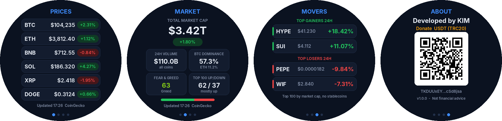

# Crypto Market — Zepp OS watch app

A clean, business-style crypto dashboard for **Amazfit T-Rex 2** (Zepp OS 2.x, 454×454 round screen).
No image assets are used for the UI — everything is drawn with text and vector shapes, so the app is tiny and sharp.



## Features

| Screen | What it shows |
|---|---|
| **1 · Prices** | Your watchlist (up to 6 coins): price in USD and 24h change badge |
| **2 · Market** | Total crypto market cap + 24h change, 24h volume, BTC/ETH dominance, Fear & Greed index, how many of the top 100 coins are up/down |
| **3 · Movers** | Top 2 gainers and top 2 losers of the last 24h (top 100 by market cap, stablecoins excluded) |
| **4 · About** | Developer credit and a **USDT (TRC20) donation QR code** |

- Swipe **left / right** (or press **UP / DOWN**) to switch screens. Press **SELECT** to refresh.
- Auto-refresh every 60 s while the app is open; last data is cached and shown instantly on launch.
- Watchlist is editable from the **Zepp phone app → device → Apps → Crypto Market → Settings**.
- English UI only.

## How it works

```
 Watch (page/index.js)  ── Bluetooth ──►  Zepp app on phone (app-side/index.js)  ── HTTPS ──►  public APIs
        ◄── one compact JSON with everything the 4 screens need ──
```

The watch has no internet. The Side Service (running inside the Zepp app) fetches data and sends it to the watch.

Data sources (free, no API key):
- [CoinGecko](https://www.coingecko.com/en/api) — top 100 coins, global market data (primary)
- [CryptoCompare](https://min-api.cryptocompare.com/) — fallback for prices / top 100
- [alternative.me](https://alternative.me/crypto/fear-and-greed-index/) — Fear & Greed index

## Project structure

```
app.json              App config (appId, target devices, permissions)
app.js                Starts the Bluetooth message channel
page/index.js         Watch UI: 4 screens, navigation, rendering
app-side/index.js     Side Service: fetches & aggregates market data
setting/index.js      Settings page in the Zepp app (watchlist)
utils/config.js       Theme, default watchlist, refresh time
utils/credits.js      Developer credit + donation address (protected, do not edit)
utils/format.js       Number formatting
shared/               Bluetooth messaging library (from Zepp OS samples)
assets/common/icon.png  App icon (the only image)
```

## Requirements

- [Node.js](https://nodejs.org/) 16+
- Zeus CLI: `npm i -g @zeppos/zeus-cli`
- A free Zepp developer account: <https://console.zepp.com>
- Zepp app on your phone with **Developer Mode** enabled
  (Profile → Settings → About → tap the Zepp logo 7 times)

## Setup

### 1. Set your App ID
Every Zepp app needs its own **appId**.

1. Open <https://console.zepp.com> → **Create** → choose **Mini Program / App**.
2. Copy the generated **App ID** (a number, e.g. `1134900`).
3. Open `app.json` and replace the number in:
   ```json
   "appId": 1000008,
   ```

### 2. Credits & donation
The developer credit and donation address are fixed (`utils/credits.js`, stored encoded and verified at runtime).
They are part of the license — see [LICENSE](LICENSE). A build with modified credits shows *Unofficial build* and does not load data.

### 3. Run on the watch
```bash
cd zepp-crypto-market
zeus login          # first time only
zeus preview        # builds and shows a QR code
```
Scan the QR code in the Zepp app (**Profile → Developer Mode → Scan**). The app is installed on the watch.

To use the simulator instead: install the **Zepp OS Simulator** and run `zeus dev`.

### 4. Build a package
```bash
zeus build          # creates dist/*.zab for upload to the Zepp store
```

## Other devices
The project targets the T-Rex 2 (`deviceSource` 418 / 419). To add another watch, add its
`deviceSource` from the [device list](https://docs.zepp.com/docs/reference/related-resources/device-list/)
to `targets.common.platforms` in `app.json`. The layout is designed for 454×454 round screens.

## Notes
- Phone must be nearby and connected; the Zepp app must be allowed to run in the background.
- Public APIs have rate limits; the app refreshes at most once a minute.
- **Not financial advice.** Data is provided "as is" by third-party services.

## Support
If you find this useful, a USDT (TRC20) donation is welcome — scan the QR code on the **About** screen, or send to:

```
TKDUUxEYfFnUVZsEgMMiy2jPiUPcSd8jsa
```
(USDT on the **TRON / TRC20** network only)

## License
MIT with attribution & donation clause — see [LICENSE](LICENSE) © KIM
