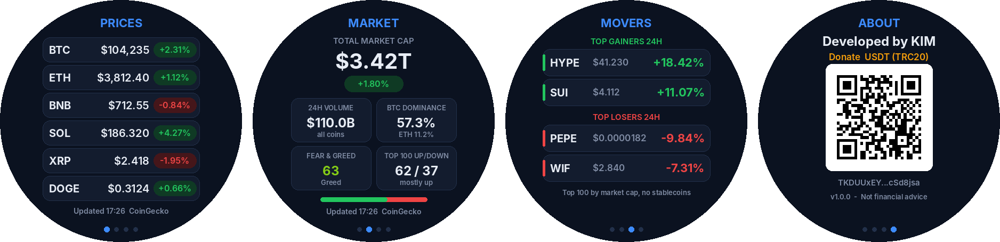

<div dir="rtl">

# Crypto Market — تطبيق أسعار العملات الرقمية لساعة Amazfit T-Rex 2

[English](README.md) | **العربية**

تطبيق احترافي بتصميم تجاري لساعة **Amazfit T-Rex 2** (نظام Zepp OS)، يعرض أسعار العملات الرقمية وحركة السوق مباشرة على معصمك.
الواجهة باللغة الإنكليزية، ومرسومة بالكامل بالنصوص والأشكال **بدون أي صور**، لذلك التطبيق خفيف وسريع وواضح.



---

## ✨ المميزات

التطبيق مكوّن من **4 صفحات**:

| الصفحة | ماذا تعرض |
|---|---|
| **1 — PRICES (الأسعار)** | أسعار حتى 6 عملات تختارها بالدولار، مع نسبة التغير خلال 24 ساعة (أخضر صعود / أحمر هبوط) |
| **2 — MARKET (حركة السوق)** | القيمة السوقية الكلية ونسبة تغيرها، حجم التداول اليومي، هيمنة البيتكوين والإيثيريوم، مؤشر الخوف والطمع، وعدد العملات الصاعدة والهابطة من أكبر 100 عملة مع شريط يوضح النسبة |
| **3 — MOVERS (الأكثر حركة)** | أكثر عملتين صعوداً وأكثر عملتين هبوطاً خلال 24 ساعة (من أكبر 100 عملة، بدون العملات المستقرة) |
| **4 — ABOUT (حول)** | "Developed by KIM" ورمز QR للتبرع بعملة USDT على شبكة TRC20 |

- **التنقل:** اسحب يميناً/يساراً على الشاشة، أو استخدم زرّي **UP / DOWN** في الساعة.
- **تحديث فوري:** زر **SELECT**.
- **تحديث تلقائي:** كل دقيقة ما دام التطبيق مفتوحاً.
- **عند الفتح:** تظهر آخر بيانات محفوظة فوراً، ثم تُحدَّث.
- **اختيار العملات:** من تطبيق Zepp على الهاتف ← الساعة ← التطبيقات ← Crypto Market ← الإعدادات.

---

## ⚙️ كيف يعمل؟

```
الساعة  ── بلوتوث ──►  تطبيق Zepp على الهاتف  ── إنترنت ──►  مصادر البيانات
         ◄── ملخص واحد بكل بيانات الصفحات الأربع ──
```

الساعة لا تتصل بالإنترنت بنفسها؛ تطبيق Zepp على الهاتف يجلب البيانات ويرسلها للساعة.

**مصادر البيانات (مجانية وبدون مفتاح API):**
- **CoinGecko** — الأسعار وأكبر 100 عملة وبيانات السوق الكلية (المصدر الأساسي)
- **CryptoCompare** — مصدر احتياطي إذا تعذّر الأول
- **alternative.me** — مؤشر الخوف والطمع

---

## 🛠️ المتطلبات

1. **Node.js** — من الموقع https://nodejs.org
2. **أداة Zeus** — بعد تثبيت Node.js افتح موجه الأوامر واكتب:
   ```
   npm i -g @zeppos/zeus-cli
   ```
3. **حساب مطوّر مجاني** على https://console.zepp.com
4. **وضع المطوّر في تطبيق Zepp على الهاتف:**
   الملف الشخصي ← الإعدادات ← حول ← اضغط على شعار Zepp **7 مرات**.

---

## 🚀 طريقة التشغيل

### 1) تنزيل المشروع
اضغط الزر الأخضر **Code** أعلى هذه الصفحة ← **Download ZIP**، ثم فكّ الضغط.

### 2) رقم التطبيق (App ID)
كل تطبيق على ساعات Zepp يحتاج رقماً خاصاً به:
1. ادخل https://console.zepp.com
2. اضغط **Create** واختر **App (Mini Program)**.
3. انسخ الرقم الذي يظهر (مثل `1134900`).
4. افتح ملف `app.json` وضع رقمك مكان الرقم الموجود في السطر:
   ```json
   "appId": 1000008,
   ```

> رقم التطبيق ليس سرّياً، لكنه مرتبط بحساب المطوّر؛ لذلك من يريد نشر التطبيق في متجر Zepp يحتاج رقمه الخاص.

### 3) التثبيت على الساعة
افتح موجه الأوامر داخل مجلد المشروع واكتب:
```
zeus login
zeus preview
```
سيظهر رمز QR على الشاشة. افتح تطبيق Zepp على الهاتف ← الملف الشخصي ← **Developer Mode** ← **Scan** وامسح الرمز، فيتثبت التطبيق على الساعة.

> للتجربة على المحاكي بدلاً من الساعة: ثبّت **Zepp OS Simulator** ثم نفّذ `zeus dev`.

### 4) بناء حزمة للنشر (اختياري)
```
zeus build
```
تُنشأ الحزمة داخل مجلد `dist` ويمكن رفعها إلى متجر Zepp.

---

## 📁 هيكل المشروع

| الملف / المجلد | الوظيفة |
|---|---|
| `app.json` | إعدادات التطبيق: رقم التطبيق، الأجهزة المدعومة، الصلاحيات |
| `app.js` | تشغيل قناة الاتصال بالبلوتوث |
| `page/index.js` | واجهة الساعة: الصفحات الأربع والتنقل والعرض |
| `app-side/index.js` | خدمة الهاتف: جلب البيانات من الإنترنت وتجميعها |
| `setting/index.js` | صفحة الإعدادات في تطبيق Zepp (اختيار العملات) |
| `utils/config.js` | الألوان، العملات الافتراضية، فترة التحديث |
| `utils/credits.js` | اسم المطوّر وعنوان التبرع (محميّ — لا يُعدَّل) |
| `utils/format.js` | تنسيق الأرقام والأسعار |
| `shared/` | مكتبة الاتصال بالبلوتوث (من أمثلة Zepp OS الرسمية) |

---

## 📱 أجهزة أخرى
المشروع مضبوط لساعة **T-Rex 2** (رمزا الجهاز `418` و `419`).
لإضافة ساعة أخرى أضف رمزها من [قائمة أجهزة Zepp](https://docs.zepp.com/docs/reference/related-resources/device-list/) إلى `platforms` داخل `app.json`.
التصميم مخصص للشاشات الدائرية بدقة 454×454.

---

## ⚠️ ملاحظات
- يجب أن يكون الهاتف قريباً ومتصلاً بالساعة وبالإنترنت، وتطبيق Zepp يعمل في الخلفية.
- المصادر المجانية لها حد لعدد الطلبات، لذلك يتحدث التطبيق مرة كل دقيقة كحد أقصى.
- **هذا التطبيق ليس نصيحة مالية.** البيانات مقدّمة كما هي من مصادر خارجية.

---

## 🔒 الحقوق وعنوان التبرع
اسم المطوّر **KIM** وعنوان التبرع ثابتان ومحميّان داخل التطبيق، وهما شرط من شروط الرخصة.
أي نسخة يُعدَّل فيها الاسم أو العنوان تظهر عليها رسالة **UNOFFICIAL BUILD** ولا تعرض البيانات.

---

## ❤️ الدعم
إذا أعجبك التطبيق يمكنك دعم المطوّر بالتبرع بعملة **USDT على شبكة TRC20** فقط:

```
TKDUUxEYfFnUVZsEgMMiy2jPiUPcSd8jsa
```

أو امسح رمز QR في صفحة **ABOUT** داخل التطبيق.

---

## 📄 الرخصة
رخصة MIT مع شرط الإبقاء على اسم المطوّر وعنوان التبرع — راجع ملف [LICENSE](LICENSE).
© KIM

</div>
